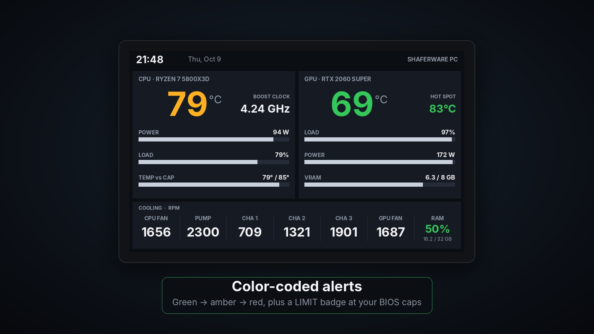
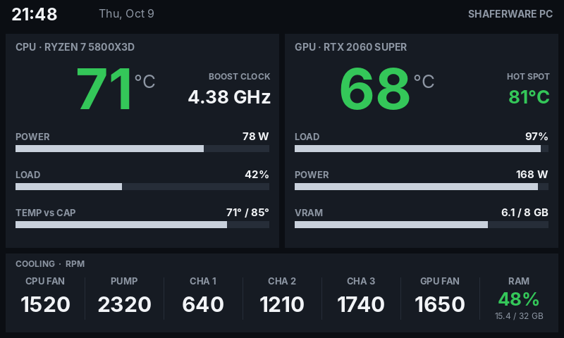
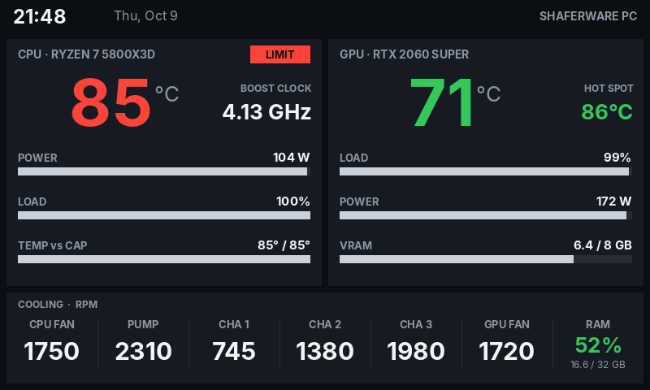
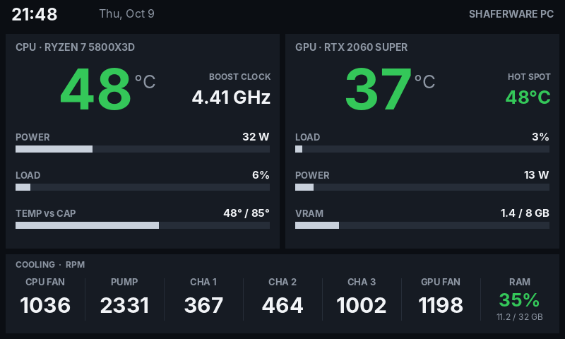
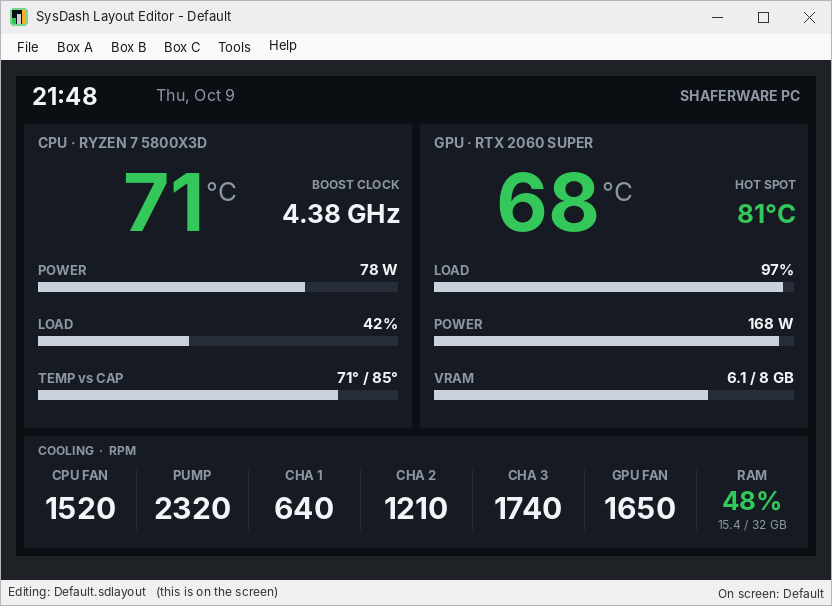
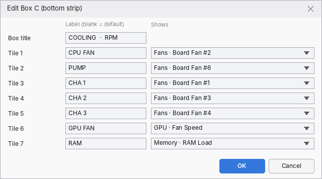

<p align="center">
  
</p>

<h1 align="center">ShaferWare SysDash</h1>

<p align="center"><strong>Your PC's vitals on a VoCore screen.</strong><br>
Live CPU, GPU, fan, pump and RAM stats in one small app. No SimHub. No HWiNFO. No subscription.</p>

<p align="center">
  <a href="../../releases/latest"><strong>⬇ Download the latest version (Windows)</strong></a>
  &nbsp;·&nbsp;
  <a href="https://shaferware.net/sysdash">shaferware.net/sysdash</a>
</p>



SysDash is freeware. This repository holds the downloads, documentation and issue tracker; the source code is not published.

## Features

- **Live sensors**: CPU and GPU temperatures, power, clocks and load, plus fans, pump, RAM and VRAM, updated every 2 seconds.
- **Layout Editor**: Click any of the three boxes and pick what it shows, from built-in favorites or any sensor on your PC. Save as many layouts as you like.
- **Smart alerts**: Values go green, then amber, then red. A LIMIT badge lights when the CPU reaches your BIOS temperature or power cap. A stalled pump turns red right away.
- **Tiny footprint**: About 40 MB of RAM and 0.1% CPU. One app reads the sensors, draws the dashboard and drives the screen.
- **Clean shutdown**: The screen goes dark when Windows shuts down or sleeps, so it never freezes on the last frame.
- **Your branding**: Put your name, company or PC name in the header.

| Gaming load | At the BIOS cap | Idle |
|---|---|---|
|  |  |  |

## Download

Get the zip from the [latest release](../../releases/latest). Each release lists the file's SHA-256 so you can check your download:

```powershell
Get-FileHash .\ShaferWare-SysDash-0.2.zip
```

## Requirements

- Windows 10 or 11, 64-bit (.NET Framework 4.7.2, which is built into Windows)
- VoCore USB screen, 800x480 (tested on the 5" V7B panel)
- The VoCore USB driver (WinUSB/libusb). If SimHub has already driven your screen, the driver is installed.
- The PawnIO driver, used to read CPU temperatures and motherboard fans. The LibreHardwareMonitor app installs it.
- Close SimHub before starting SysDash, because only one program can drive the screen at a time.

## Quick start

1. Plug in your VoCore screen.
2. Unzip SysDash and run `ShaferWareSysDash.exe` (it asks for administrator access to read CPU temperatures and fans).
3. Double-click the tray icon to open the Layout Editor, choose what to show, then press **F5** to apply it to the screen.
4. Optional: run `install.bat` as administrator to start SysDash with Windows.

## Layout Editor basics



- **Box A** is the left panel, **Box B** the right panel and **Box C** the bottom strip.
- Click a box in the preview, or use the Box A / Box B / Box C menus, to choose what each part shows. Presets are in the same menus.
- Any sensor LibreHardwareMonitor sees can be picked (at the bottom of each list).
- **File > New / Open / Save / Save As** work like any program. Layouts are `.sdlayout` files in the `Layouts` folder.
- **File > Apply to Screen (F5)** puts the layout on the VoCore and makes it the one used at startup. Saving the layout that is already on the screen updates the screen too.
- **Tools > Header Text** changes the name at the top right.
- Brightness, mirroring, the CPU temperature cap and the power limit are in `settings.ini`: tray icon > **Screen & limit settings**, then **Reload settings**.



## FAQ

**Do I need SimHub or HWiNFO?**
No. SysDash reads the sensors itself with LibreHardwareMonitorLib and drives the VoCore screen directly. If SimHub is installed, close it before starting SysDash, because only one program can drive the screen at a time.

**Why does it ask for administrator access?**
Windows only lets programs with administrator rights read CPU temperatures, power and motherboard fan speeds (through the PawnIO driver). Without it those values would be missing. `install.bat` sets up a logon task so SysDash can start with Windows without a prompt every time.

**Something isn't working. Where do I look?**
Check `sysdash.log` in the SysDash folder (tray icon > **Open log**), then [open an issue](../../issues/new/choose).

## Reporting bugs

Use the [bug report form](../../issues/new/choose). Please include your Windows version, CPU, motherboard, GPU, VoCore model and the contents of `sysdash.log`. Do not post personal information. See [SECURITY.md](SECURITY.md) for security issues.

## License and credits

- SysDash is freeware: free for personal and commercial use, shared only unmodified and free of charge. See [LICENSE.txt](LICENSE.txt).
- Sensor reading: [LibreHardwareMonitorLib](https://github.com/LibreHardwareMonitor/LibreHardwareMonitor) (MPL 2.0). USB: [libusb](https://github.com/libusb/libusb) (LGPL 2.1). Full list in [THIRD-PARTY.txt](THIRD-PARTY.txt).
- VoCore and SimHub are trademarks of their respective owners. SysDash is not affiliated with either.

Project page: **https://shaferware.net/sysdash**
